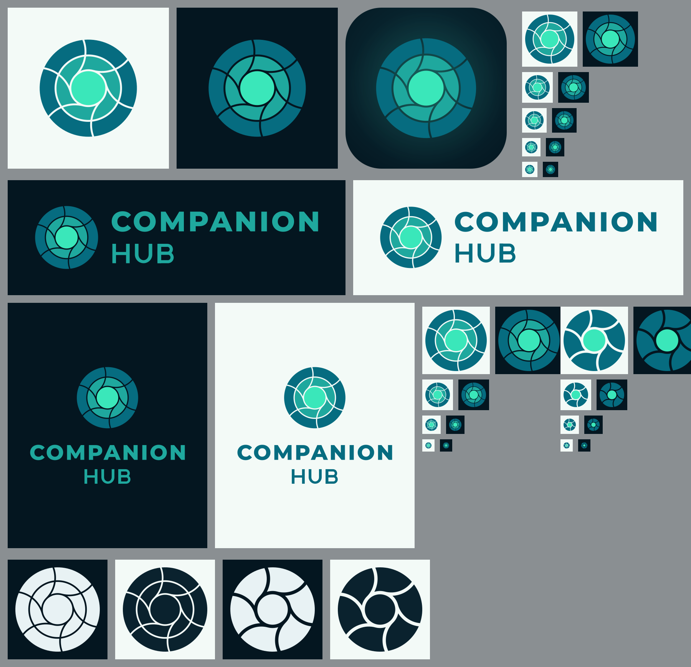

# hub-brand



The Companion Hub's own mark, and every icon derived from it. This folder is the **origin**: the files the Hub serves, bundles, and builds its app icons from are mirrors of it.

## Two brand folders, two owners

| Folder | Owner | Holds | Edit by hand? |
| --- | --- | --- | --- |
| [`brand/`](../brand) | CI Common | The Companion Intelligence company logo, vendored and `sha256`-stamped in [`ci-common.vendor.json`](../ci-common.vendor.json). | No. Refresh it with `node scripts/vendor-ci-common.mjs --from <ci-common checkout> --ref <tag>`, as [DEVELOPMENT_SETUP.md](../../../docs/DEVELOPMENT_SETUP.md) describes. |
| `hub-brand/` (this folder) | This repo | The Companion Hub mark, app icon, favicons, and lockups. | No. Regenerate it with the scripts below. |

Use the Hub mark wherever the product says "this app": the header, sign-in and onboarding screens, the mobile connect screen, favicons, app icons, tray, setup, and bootstrap pages. Use the company logo from `brand/` where Companion Intelligence speaks as a company (attribution, an About page). No served or bundled Hub screen does today, so `sync-brand.mjs` mirrors nothing from `brand/`.

## The mark

A bright core, the Companion, with six facets docked around it, the apps the Hub installs and supervises. Curved gaps leave the core tangentially and sweep out to the rim. A Smith chart has one point where all its resistance circles are tangent and every reactance arc passes through; the mark stylizes that single meeting point, which is what a hub is. It uses the CI mark's three teals (`#066c80`, `#1fa89e`, `#3ae7ba`) and the same thin transparent gaps.

**Use the small mark at 48 px and below.** The full mark's thin gaps close up at that size. The small mark has no middle ring, wider gaps, and a larger core.

| File | Use |
| --- | --- |
| `logos/mark.svg` | Default, with a quarter of the mark's height as clear space. Served as `public/hub-mark.svg` for the mobile connect screen. |
| `logos/mark-tight.svg` | Cropped to the disc. README, `public/hub.png`, `app-icon-source.png`. |
| `logos/mark-small.svg` | Header icon, QR center, favicons, setup and bootstrap logos, tray. |
| `logos/mark-mono.svg`, `logos/mark-small-mono.svg` | One ink (`currentColor`). |
| `logos/lockup*.svg` | Mark with the two-line wordmark: beside or below, for dark or light grounds, or in one ink. |
| `logos/app-icon.svg` | The mark on the canon dark tile, rounded. |
| `logos/app-icon-square.svg` | Same tile, full-bleed and square, for surfaces that apply their own mask (apple-touch, maskable PWA icons). |
| `logos/app-icon-small.svg` | The tile with the small mark, for the tile at 64 px and below. |
| `logos/app-icon-source.png` | 1024 px transparent disc, edge to edge. The one input to `tauri icon`. |
| `icons/png/` | Favicons, apple-touch and PWA icons, tray image, and the sizes the setup and bootstrap pages use. |

## Where the files go

`scripts/sync-brand.mjs` mirrors these files into `public/`, `src/assets/`, `packages/desktop/bootstrap/assets/`, and `packages/desktop/src-tauri/icons/` (`tray.png`, `icon.svg`), and into `packages/mobile/src-tauri/icons/icon.svg`. `brand:check`, part of `lint:canon`, fails when a copy drifts. The API embeds `icons/png/favicon-96.png` as base64, its test fails on drift, and `turbo.json` lists this folder as an input of the cached backend test.

The desktop and mobile app icons come from `app-icon-source.png` through Tauri:

```bash
pnpm --filter desktop icons   # cargo tauri icon …/app-icon-source.png
pnpm --filter mobile icons    # same, with iOS icons on the canon dark #041620
```

Both run `scripts/post_tauri_icons.py` afterwards, because `tauri icon` gets this mark wrong in six ways: it scales the full mark down to every small size; it writes the iOS 1024 px marketing icon with an alpha channel that App Store Connect rejects; it writes the Android hdpi launcher icon at 49 px where the committed set and `mobile-icons.test.ts` want 72; it draws the Android adaptive foreground edge to edge so launcher masks crop the outer ring; it leaves `icons/ios` and `icons/android` stale in `packages/mobile`; and it strips the newline from `ic_launcher_background.xml`. The script fixes all six and is safe to run again.

The tray (`src-tauri/src/tray.rs`) loads `icons/tray.png`, the small mark. macOS draws a template icon from its alpha channel alone, so the full mark would show as a solid disc.

The website's Android card icon, `apps/site/public/download/apps/ci-hub.png` in CI-Public-Website, is `logos/app-icon-small.svg` rendered at 256 px (`rsvg-convert -w 256 logos/app-icon-small.svg`). It is a copy in another repo, so it does not update itself.

## Regenerate

```bash
cd packages/frontend/hub-brand
python3 scripts/build_hub_logo.py .      # logos/*.svg, standard library only
python3 scripts/build_hub_rasters.py     # PNG and ICO; needs rsvg-convert and Pillow
cd .. && node scripts/sync-brand.mjs     # refresh the mirrors
```

`build_hub_logo.py` solves every facet exactly from circle intersections and writes flat paths: no masks, strokes, or filters.

## The wordmark

The COMPANION line reuses the outlines in `CI-Common/assets/logos/wordmark.svg`. The lockups were built from that file at commit `cadb8637` (2026-10-17), `sha256` `9bf3e52cf015cd20addca42332a55c387002ae73463fcfc9eb4e0676a2605d51`. The script finds the file on its own in a workspace checkout, or you can set `CI_WORDMARK=/path/to/wordmark.svg`. Rebuild the lockups when that file changes.

The HUB line is drawn to match the regular-weight INTELLIGENCE line (cap height, stem, bar thickness, and spacing) because Montserrat is not in this repo. If Montserrat becomes available, typeset HUB from the font instead.

## Status

The Hub mark is not yet registered in CI Common's `assets/logos/` manifest. Until it is, this folder is the only origin.
